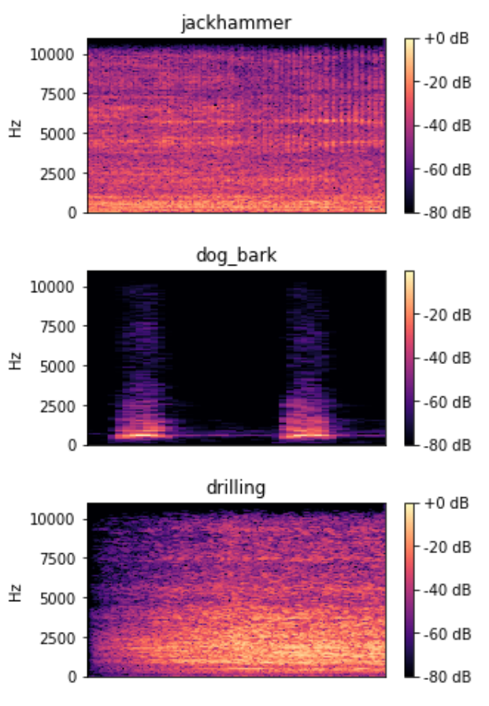
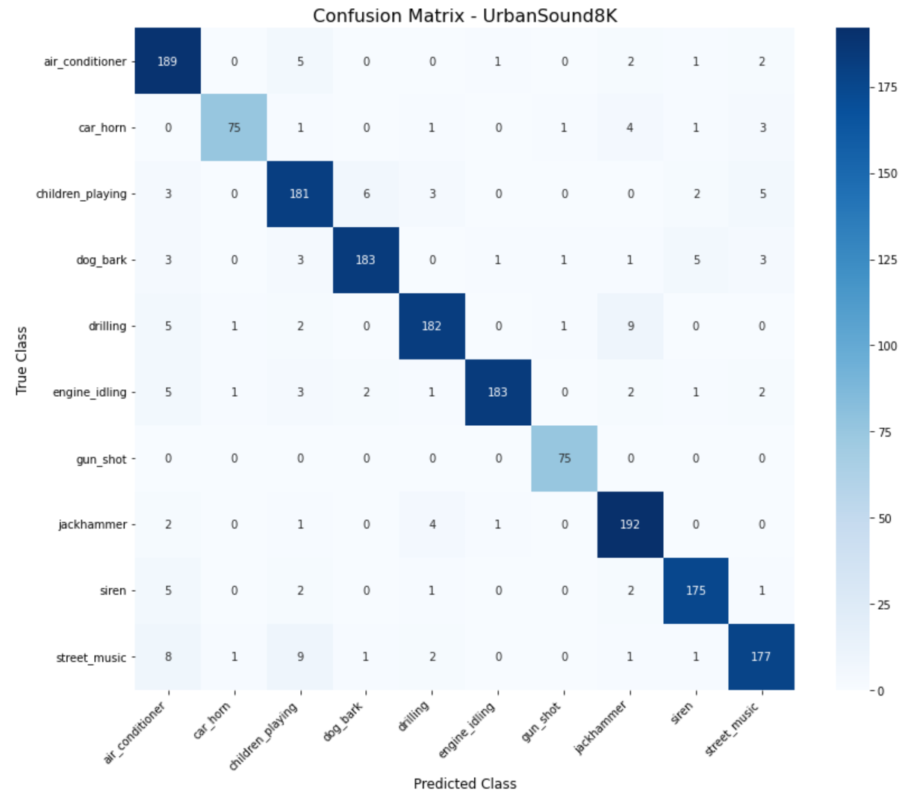

# 🎧 Urban Sound Classification: 2D CNN & Log-Mel Spectrograms


## 📖 Project Overview
This project presents a complete end-to-end audio classification pipeline designed to categorize 10 different urban sounds (e.g., sirens, gunshots, dog barks) using the **UrbanSound8K dataset** (8,732 audio files). 

The primary objective was to improve upon a traditional academic baseline by treating audio signals not as 1D sequences, but as **2D acoustic images**. By leveraging the power of Convolutional Neural Networks (CNNs), the model learns both spatial harmonics (horizontal patterns) and temporal changes (vertical patterns) simultaneously.

## ⚙️ Methodology & Pipeline
1. **Audio Preprocessing:** Standardized all audio clips to 22,050 Hz and normalized their lengths to exactly 4 seconds (padding short clips and truncating long ones).
2. **Feature Engineering (2D Representation):** Instead of traditional 1D features (like averaged MFCCs), I extracted **Log-Mel Spectrograms**. This converted the audio into 2D grayscale "images" (Frequency × Time).
3. **CNN Architecture:** Designed a custom 2D CNN from scratch with three convolutional blocks. Key architectural choices include:
   * **SpatialDropout2D:** Used instead of standard Dropout to drop entire correlated feature maps (preventing overfitting in spectrograms).
   * **GlobalAveragePooling2D:** Replaced `Flatten` to keep the model highly parameter-efficient (~129,000 parameters).
4. **Training Strategy:** Utilized `EarlyStopping` and `ReduceLROnPlateau` to dynamically adjust the learning rate and stop training at the optimal epoch to prevent overfitting.

## 🏆 Results
The 2D CNN achieved an excellent overall accuracy of **92.2%** on the unseen test set, outperforming the baseline approach. The lightweight architecture ensures fast inference and a low memory footprint.

| Metric | Score |
| :--- | :--- |
| Overall Accuracy | 92.2% |
| Macro F1-Score | 0.93 |
| Best Performing Class | Gun Shot (F1: 0.98) |

## 💡 Key Insights
* **Image Processing for Audio:** Converting 1D audio signals into 2D Log-Mel spectrograms allows CNNs to directly apply image-processing techniques to audio, yielding higher accuracy than traditional audio feature extraction.
* **Acoustic Similarities:** The model's few errors (e.g., confusing "drilling" with "jackhammer") proved that it learned true acoustic properties, as both are repetitive, percussive construction sounds with highly overlapping spectral signatures.
* **The Power of Regularization:** Interestingly, the validation accuracy (~92.2%) was higher than the training accuracy (~88%). This proves that the heavy regularization techniques (SpatialDropout2D and BatchNorm) actively made learning harder during the training phase, but allowed the model to generalize exceptionally well on unseen data.

## 📊 Visualizations




## 📂 Repository Structure
```text
├── notebooks/
│   └── urban-sound-classification.ipynb    # Main Jupyter Notebook
├── requirements.txt                        # Python dependencies
└── README.md                               # Project documentation                            # Project documentation
```

## 🚀 How to Run
1. Clone the repository:
   git clone https://github.com/AliPakzad/Urban-Sound-Classification-2D-CNN.git

2. Install the required packages:
   pip install -r requirements.txt

3. Open the Jupyter Notebook and run the cells:
   jupyter notebook notebooks/urban-sound-classification.ipynb

## 🔗 Links
* **Kaggle Notebook:** https://www.kaggle.com/code/alipakzad/sound-classification-with-2d-cnn-log-mel-93-acc
* **LinkedIn:** https://www.linkedin.com/in/ali-pakzad-b145a3b4
* **GitHub Profile:** https://github.com/AliPakzad

---
**Author:** Ali Pakzad (Data Scientist & ML Engineer)
